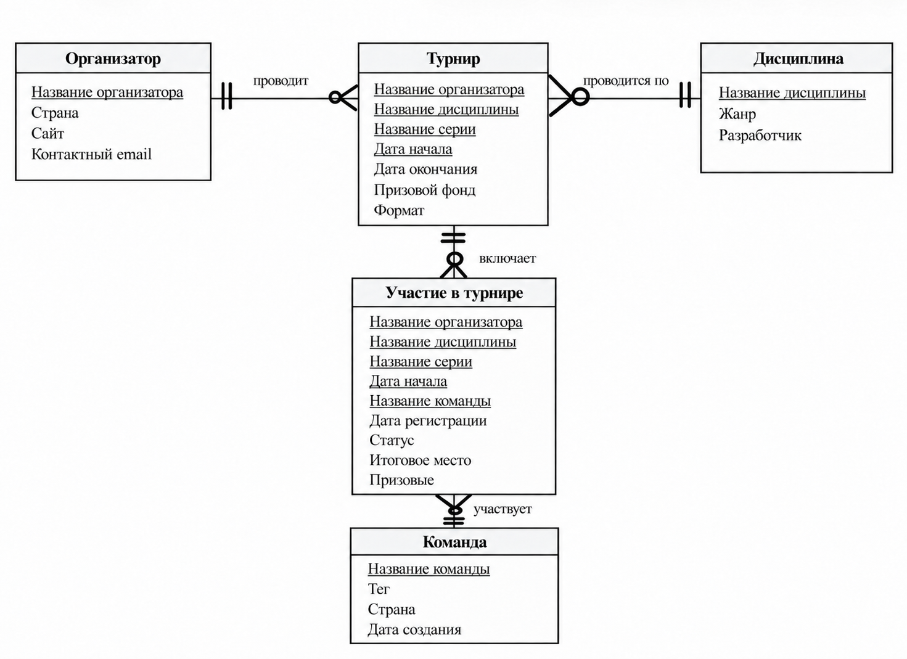

# Лабораторная №1. ER-модель

Моделирование системы управления киберспортивными турнирами: сущности, атрибуты, идентификаторы и кардинальности связей.

Предметная область — «Турнирный оператор». 

- [Готовый отчёт PDF](report.pdf).
- [Доступный исходник LaTeX](source/report.tex).
- [Схема](source/labdb1.png).

