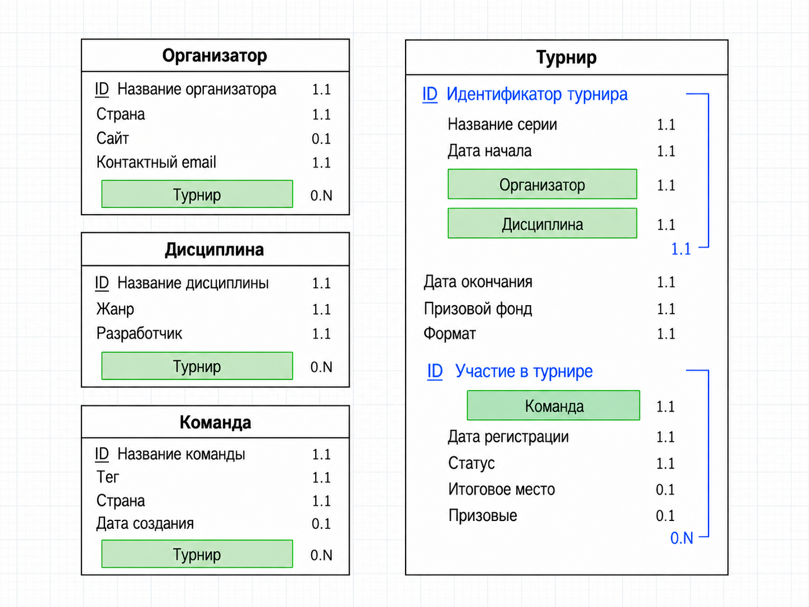

# Лабораторная №2. Модель семантических объектов

Объекты предметной области, простые и объектные атрибуты, групповой атрибут участия в турнире и обоснование кардинальностей.

Предметная область — «Турнирный оператор». 

- [Готовый отчёт PDF](report.pdf).
- [Доступный исходник LaTeX](source/report.tex).
- [Схема](source/labdb2.png).

